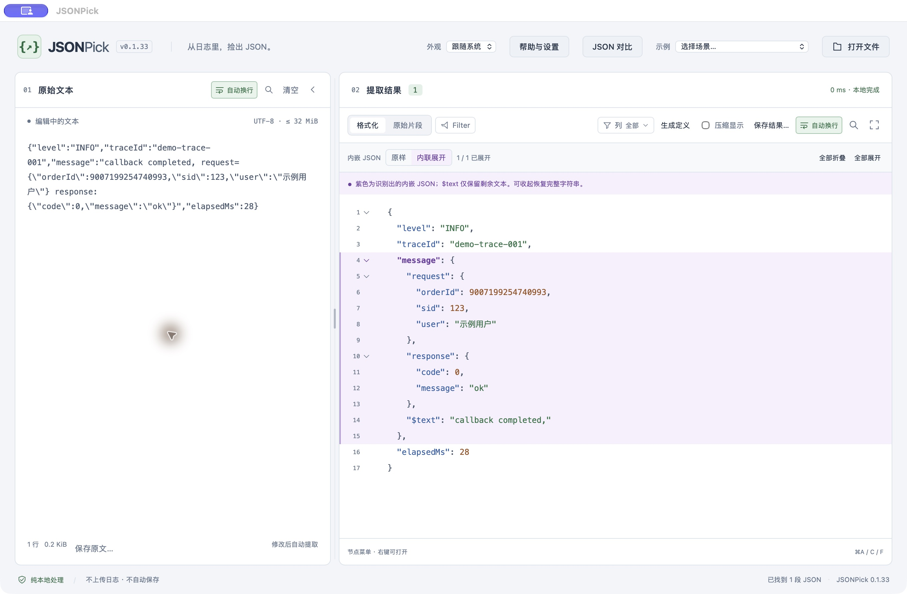

# JSONPick

**从杂乱日志中，直接找到能用的 JSON。**

面向开发者的本地日志 JSON 工具。粘贴混合日志或接口响应，自动提取 JSON；转义字符串中的 request / response 也能在当前窗口展开查看。

[下载 Mac / Windows 版本](https://github.com/arvintool/jsonpick-releases/releases/tag/v0.1.33) · [安装与激活](docs/安装与激活.md) · [使用与许可](docs/使用与许可说明.md)

*0.1.33 实际界面，使用合成日志演示。紫色区域是从 message 字符串中识别并展开的 JSON，长整数保持原值。*

## 核心能力

| 你遇到的情况 | JSONPick 可以帮你做什么 |
| --- | --- |
| 日志里夹着 JSON，拷贝后还要删前缀、去转义 | 自动提取，原样与内联展开切换，保留原始片段 |
| message 里又有 request / response | 在当前窗口内联查看，按节点复制 |
| 日志被截断，整个 JSON 格式化失败 | 展示可确认的字段，并标出错误和来源位置 |
| 数组记录太多、字段太杂 | 切换表格、选择列、筛选与排序，导出 ID 或 SQL IN 片段 |
| 长整数、小数、字段顺序不能变 | 保留数字字面量、字段顺序和重复字段 |

还支持结构对比、按 key / value 查找，以及 Java、Go、Protobuf、Thrift 定义草稿。日志解析在本机完成，无需上传日志。

## 下载

当前版本 **0.1.33**，为试用候选版。

| 电脑 | 安装包 | 体积 |
| --- | --- | --- |
| Mac · Apple M 系列 | [下载 ZIP](https://github.com/arvintool/jsonpick-releases/releases/download/v0.1.33/JSONPick-0.1.33-candidate-macos-arm64.zip) | 4.2 MiB |
| Mac · Intel | [下载 ZIP](https://github.com/arvintool/jsonpick-releases/releases/download/v0.1.33/JSONPick-0.1.33-candidate-macos-amd64.zip) | 4.6 MiB |
| Mac · 通用版 | [下载 ZIP](https://github.com/arvintool/jsonpick-releases/releases/download/v0.1.33/JSONPick-0.1.33-candidate-macos-universal.zip) | 8.6 MiB |
| Windows · x64 | [下载 ZIP](https://github.com/arvintool/jsonpick-releases/releases/download/v0.1.33/JSONPick-0.1.33-candidate-windows-amd64.zip) | 4.9 MiB |

[查看本版全部附件与 SHA256SUMS 校验清单](https://github.com/arvintool/jsonpick-releases/releases/tag/v0.1.33)。请下载 **JSONPick 命名的程序 ZIP**；GitHub 自动生成的 **Source code (zip / tar.gz)** 只是说明仓库的归档，不能作为程序运行。

Mac 要求 macOS 13+，当前未公证。Windows 目标为 Windows 10 / 11 x64，需要 WebView2，完整兼容性仍在验证。首次安装方式和当前验收范围见[安装与激活](docs/安装与激活.md)。

## 三步开始

1. 下载对应系统的 ZIP，完整解压后打开 JSONPick。
2. 粘贴日志或打开文本文件，自动提取其中的 JSON。
3. 展开内嵌字段，查找 / 筛选后复制所需内容，或主动保存结果。

## 试用与授权

提供 **14 天试用**。**试用结束后继续使用需要付费授权**；当前暂未开放购买，购买方式开放后会在本仓库说明。

个人授权适用于本人最多 2 台设备，可组合使用 Mac / Windows，包含购买后至少 1 年更新；权益覆盖的版本可持续使用。具体使用范围见[使用与许可](docs/使用与许可说明.md)，交付和找回流程见[交付与售后](docs/交付与售后.md)。

## 隐私与反馈

日志在本机处理，不自动保存历史；退出前请主动保存需要保留的内容。外部媒体的网络访问方式见[隐私说明](docs/隐私说明.md)。

[反馈问题](https://github.com/arvintool/jsonpick-releases/issues)时，请提供系统与 JSONPick 版本、操作步骤和合成最小示例；不要提交生产日志、令牌、订单或完整授权码。

本仓库用于安装包发行和使用说明，应用源码未在此提供。[隐私说明](docs/隐私说明.md) · [使用与许可](docs/使用与许可说明.md) · [第三方声明](docs/THIRD-PARTY-NOTICES.txt)
