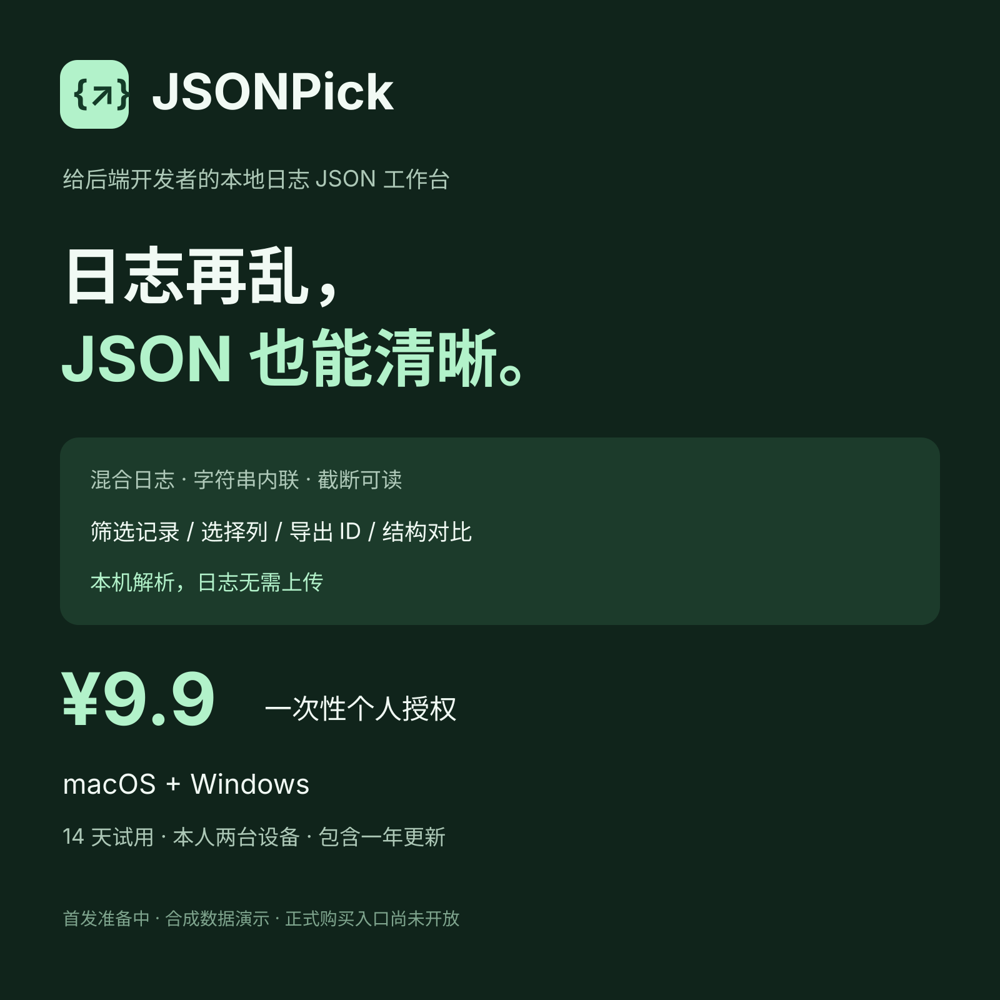

# JSONPick

从混合日志中提取、展开、筛选和复制 JSON 的本地桌面工具。

**当前 0.1.33 为商业候选，尚未公开启售或发布下载。** 本仓库用于安装包发行与使用说明；应用源码未在本仓库提供。

## 下载

安装包计划放在 GitHub 的 Releases / Assets（发行版附件）；Gitee 暂不启用，不需要另一个个人网站。当前没有已验收的公网下载地址。
- github 计划发行页（尚未发布）：https://github.com/arvintool/jsonpick-releases/releases/tag/v0.1.33

| 电脑 | 应在发行版附件中选择的文件 | 体积 |
| --- | --- | --- |
| Mac · Apple M 系列 | `JSONPick-0.1.33-candidate-macos-arm64.zip` | 4.2 MiB |
| Mac · Intel | `JSONPick-0.1.33-candidate-macos-amd64.zip` | 4.6 MiB |
| Mac · 通用版 | `JSONPick-0.1.33-candidate-macos-universal.zip` | 8.6 MiB |
| Windows · x64 | `JSONPick-0.1.33-candidate-windows-amd64.zip` | 4.9 MiB |

请下载上表附件与同一发行版的 `SHA256SUMS`。不要把 **Source code (zip / tar.gz)** 或仓库的 **Code → Download ZIP** 当作可运行安装包；它们只是本说明仓库的内容。所有买家共用对应系统的安装包，授权码单独交付。

Mac 构建要求 macOS 13+，当前临时签名、未公证。Windows 目标为 Windows 10 / 11 x64，需要 WebView2；当前只完成 Windows 11 ARM 上的 x64 核心自动检查和本人启动确认，完整桌面 / 原生 x64 验收尚未完成。

## 能处理什么

- 普通日志与 JSON 混排；字符串里的 request / response 在原窗口内联展开。
- 截断或错误内容保留可确认字段并标错，原始片段保留输入来源。
- 数组表格、列选择、组合条件筛选、排序与 ID / SQL IN 导出。
- 结构对比，以及 Java、Go、Protobuf、Thrift 定义草稿。
- 长整数、小数字面量、字段顺序和重复字段保真；日志解析在本机完成。

## 试用、购买和激活

商业版首次运行提供 14 天试用。首发方案为 **9.9 元一次性个人授权**，本人最多 2 台设备、Mac / Windows 通用，包含购买后至少 1 年更新；权益覆盖的版本可持续使用。

下载链接可以公开。付款后卖家按订单单独交付授权码，买家在软件内激活；公开下载不等于获得付费使用授权。当前没有已开放的购买入口，不在 GitHub 接收转账或公开发布授权码。

已购买用户请保留订单对应版本的发行页。更新权益按发行日期判断；后续“最新版”可能超出旧订单权益，不强制升级，历史已售版本须保留。

## 安装、隐私与售后

- [安装与激活](docs/安装与激活.md)
- [交付、授权找回与售后](docs/交付与售后.md)
- [隐私说明](docs/隐私说明.md)
- [使用与许可](docs/使用与许可说明.md) · [第三方声明](docs/THIRD-PARTY-NOTICES.txt)

订单、授权找回与退款在原购买平台处理。公开反馈不要包含生产日志、令牌、个人信息、订单号或完整授权码；请提供版本、步骤和合成示例。
